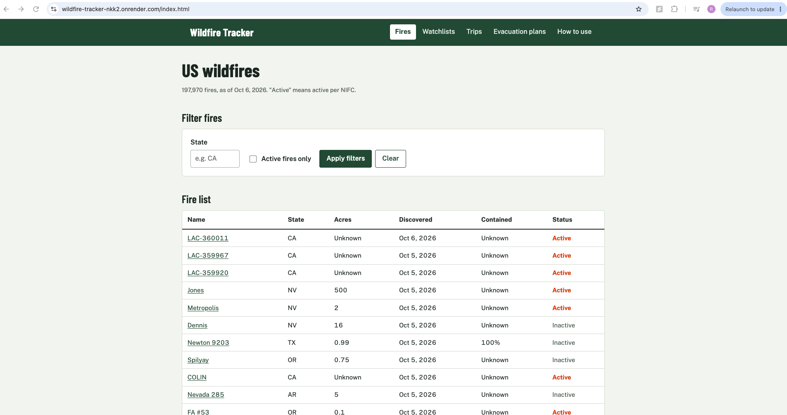

# Wildfire Tracker

Track US wildfires near the places and trips you care about.

**Live app:** https://wildfire-tracker-nkk2.onrender.com



## Authors

- Rajvi Desai
- Jharshini Vejaya Kumar

## Class

CS5610 Web Development, Northeastern University, Fall 2026
Instructor: John Alexis Guerra Gómez

## Objective

Most wildfire tools show a national map. Wildfire Tracker shows fires relative
to your own places and plans:

- **Fires:** browse and filter US wildfires from the last five years, and open
  any fire to see its details and community reports.
- **Reports** (Rajvi): post what you see near a fire, like smoke, a road
  closure, or an evacuation. Anyone can read reports; only the author can edit
  or delete them.
- **Watchlists** (Rajvi): save a place, like a family home, and see active
  fires within a radius you choose.
- **Trip plans** (Jharshini): save a hiking trip and see active fires near the
  trail.
- **Evacuation plans** (Jharshini): create a household plan and share it with
  family through a read-only link.

## Tech stack

- Node.js + Express (ES modules)
- MongoDB with the native Node.js driver
- Vanilla JavaScript (ES6 modules), HTML, and CSS, rendered in the browser
- Fire data from [NIFC Open Data](https://data-nifc.opendata.arcgis.com/)
- Deployed on Render, with MongoDB Atlas

## Run it locally

**You need:** Node.js 22 and MongoDB running locally.

```bash
git clone https://github.com/desairajviii/wildfire-tracker.git
cd wildfire-tracker
nvm use            # switches to Node 22 (optional, if you use nvm)
npm install
cp .env.example .env
npm run seed       # loads about 200,000 fires from NIFC (takes a few minutes)
npm run dev
```

Then open http://localhost:3000.

While developing, `npm run seed -- --cache` saves the NIFC download in `data/`
and reuses it, so you don't download everything each time.

### Scripts

| Command          | What it does                                         |
| ---------------- | ---------------------------------------------------- |
| `npm run dev`    | Starts the server and restarts it when files change  |
| `npm start`      | Starts the server (used by Render)                   |
| `npm run seed`   | Replaces the `fires` collection with fresh NIFC data |
| `npm run lint`   | Checks the code with ESLint                          |
| `npm run format` | Formats the code with Prettier                       |

### Environment variables

| Name        | Default                     | Purpose                               |
| ----------- | --------------------------- | ------------------------------------- |
| `MONGO_URL` | `mongodb://localhost:27017` | MongoDB connection string             |
| `DB_NAME`   | `wildfire`                  | Database name                         |
| `PORT`      | `3000`                      | Server port (Render sets this itself) |

Never commit the Atlas connection string. On Render, set it in the dashboard.

## How "accounts" work, and their limits

There's no login. Each browser creates a random ID on its first visit, stores
it in `localStorage`, and sends it with every request. The server uses it to
keep each person's watchlists, trips, and plans separate.

- **This is separation, not security.** Anyone who has an ID can access that
  ID's data. The API never returns owner IDs in responses, so they can't be
  read off public pages like reports.
- **Clearing browser data or switching browsers** loses access to what you
  saved.
- **Shared evacuation plan links** can be opened by anyone who has the link.
- Forms remind users not to enter real personal information.

## About the data

The seed script loads US wildfires from the last five years from NIFC's WFIGS
layers. "Active" means a fire is on NIFC's current incident list as of the last
seed, which can include long-running, mostly contained fires. The Fires page
shows the date of the last update.

The live map on the Fires page is Esri's US Wildfire Activity map, which uses
NIFC data and updates on its own schedule.

## Use of generative AI

We used Claude (Anthropic) as an assistant on this project.

**Rajvi:** Used Claude to plan the work, and to helped to debug the code. Claude also helped set up deployment on Render and fix a
Prettier and ESLint configuration conflict. I reviewed and tested it's changes and then implemented where needed or asked for other options if I was not convinced.

**Jharshini:**

## License

[MIT](LICENSE)
