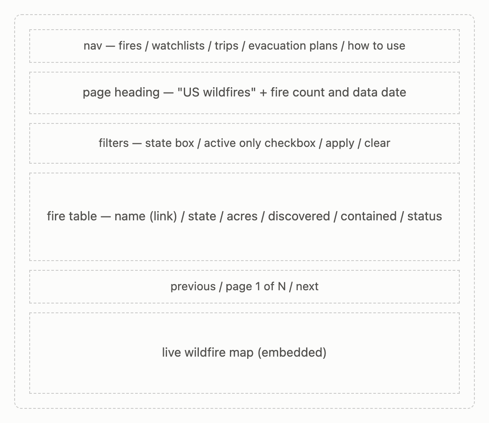
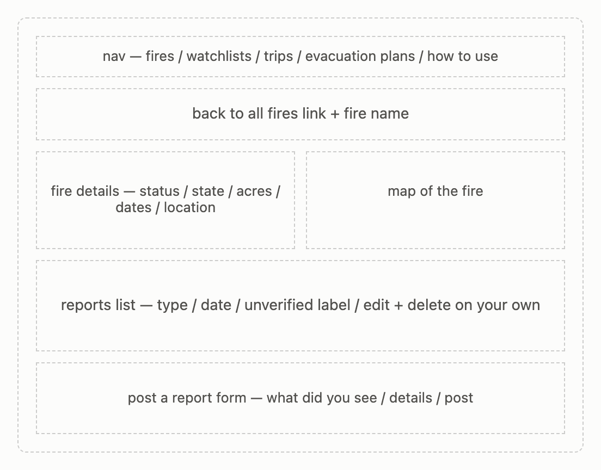
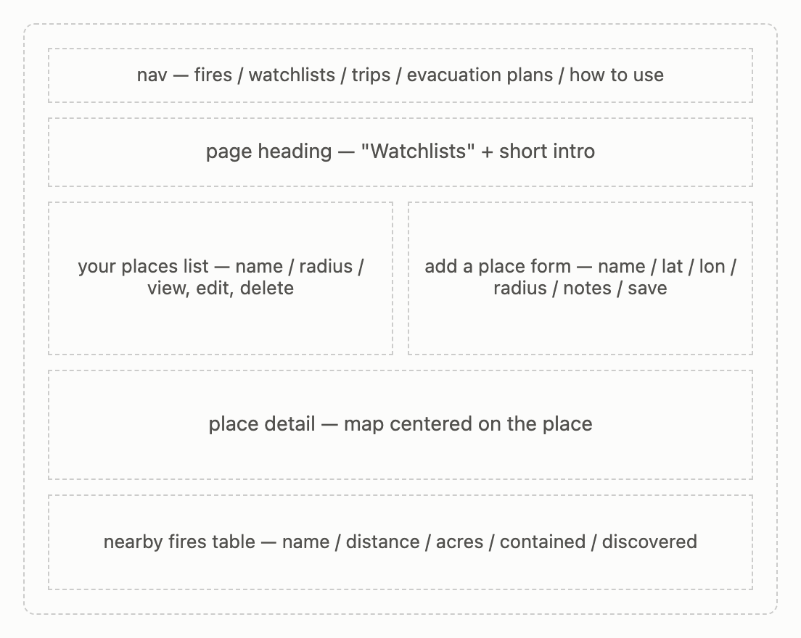
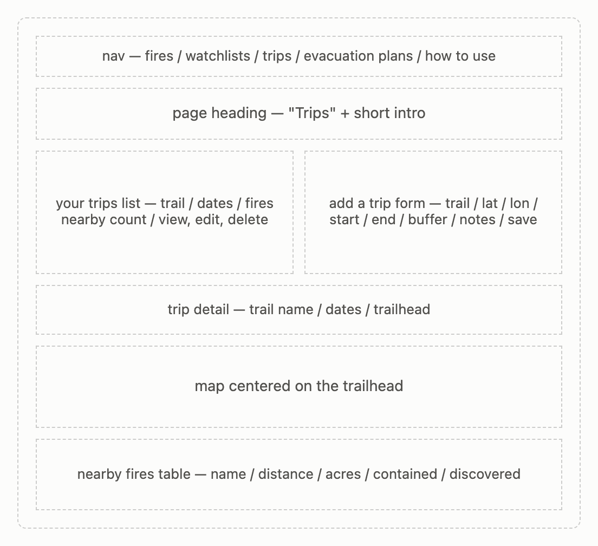
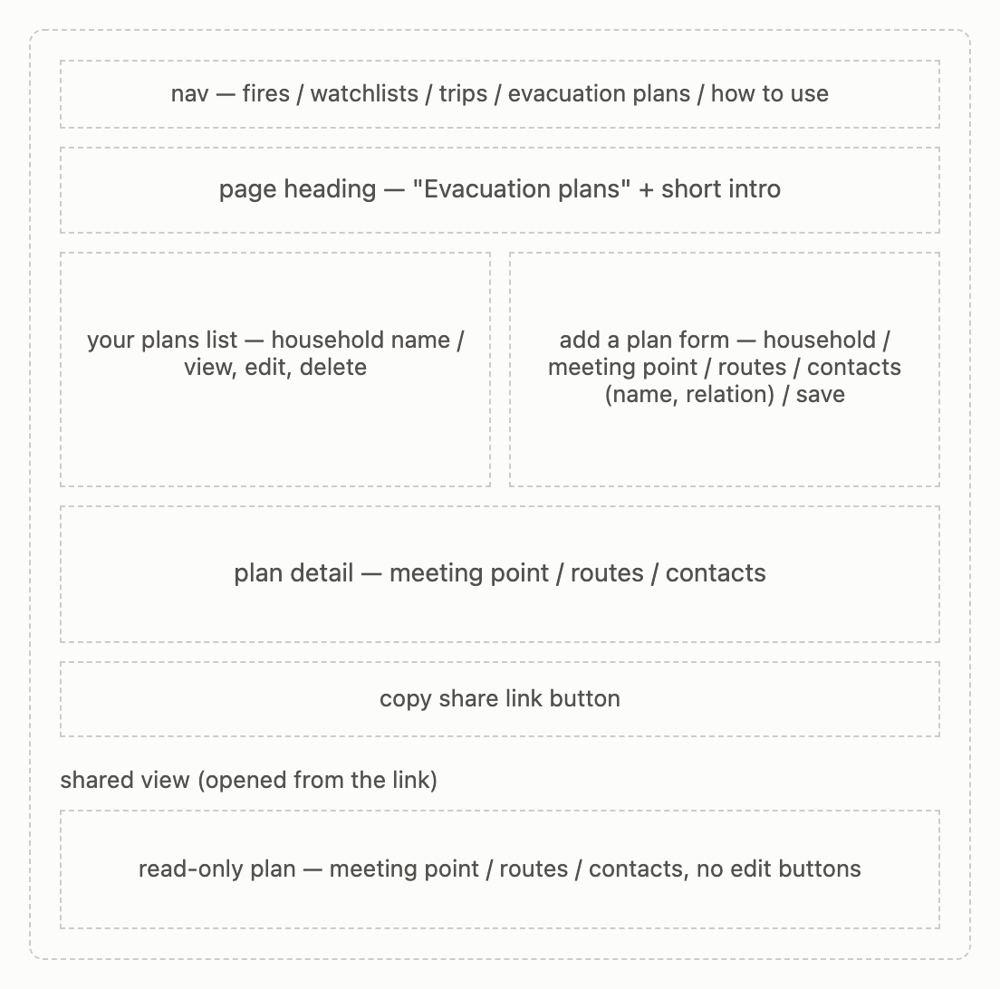
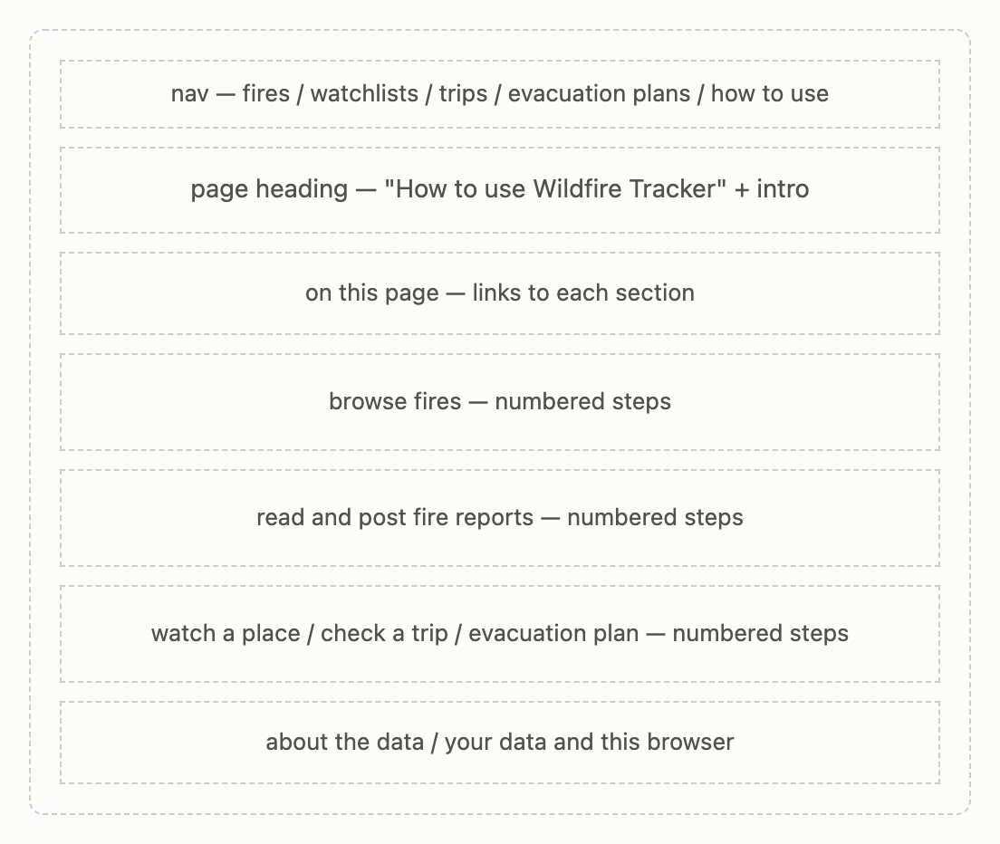

# Wildfire Tracker: Design Document

**Team:** Rajvi Desai, Jharshini Vejaya Kumar     
**Class:** CS5610 Web Development, Northeastern University, Fall 2026

## Project description

Wildfire Tracker helps people follow US wildfires in relation to the places
and trips they care about. Existing tools like Watch Duty and InciWeb show
fires on a national map, which leaves people to work out for themselves
whether a fire is near their family or their trail. Wildfire Tracker answers
those questions directly: "Is there a fire near my parents' house?" and "Are
there active fires near my trail this weekend?"

Fire data comes from NIFC Open Data (National Interagency Fire Center). A seed
script loads about 200,000 US wildfires from the last five years into MongoDB,
and users can browse and filter them by state and active status.

The app has two main parts:

- **Monitoring (Rajvi):** save places to watch, like a family home, with a
  radius in miles, and see active fires within that distance. Read and post
  community reports about a specific fire, such as smoke, road closures, or
  evacuation notes.
- **Preparedness (Jharshini):** save hiking trips with a trail location,
  dates, and a buffer distance, and see active fires near the trail. Create
  household evacuation plans and share them with family through a read-only
  link.

There's no login. Each browser gets a random ID that keeps its data separate
from other people's.

## User personas

### Maya, a household planner

Maya lives in Boston, but her parents live in a fire-prone part of California.
During fire season she checks several websites to see whether any fires are
close to their home, and she has to work out the distances herself. She wants
one place to watch their area, see what people nearby are reporting, and keep
an evacuation plan ready that she can send to the family.

**Goals:** know quickly whether a fire is near her parents; get on-the-ground
information beyond official updates; have a plan the whole family can see.

**Frustrations:** national maps make her search for the right area every time;
official updates can lag behind what people nearby are seeing.

### Jake, a hiker

Jake plans weekend hikes on trails in the West. He has had trips ruined by
smoke and trail closures he didn't know about until he arrived. He wants to
check for active fires near a trail before he drives out.

**Goals:** check his planned trails for nearby fires in one step; keep his
upcoming trips in one place.

**Frustrations:** fire maps aren't organized around trails or trip dates.

## User stories

### Rajvi: Monitoring

1. **Browse fires.** As Maya, I want to browse and filter US wildfires by state
   and active status, so that I can see what's burning in the area I care
   about.
2. **Watchlists.** As Maya, I want to save places to watch with a radius in
   miles, so that I can see active fires near my parents' home.
3. **Reports.** As Maya, I want to post and read reports about a fire (smoke,
   road closures, evacuations), so that I can share and learn what's happening
   on the ground. Only the author can edit or delete their report, and reports
   are labeled unverified.

### Jharshini: Preparedness

4. **Trip plans.** As Jake, I want to save trip plans with a trail location,
   dates, and a buffer distance, so that I can check for active fires near the
   trail before I go.
5. **Evacuation plans.** As Maya, I want to create an evacuation plan with a
   meeting point, routes, and contacts, and share it through a read-only link,
   so that my family can view it by opening the link.

## Design mockups

### Fires page (`index.html`)

Nav bar at the top, a page heading with the total fire count and the date of
the last data update, a filter bar (state and active only), and a paginated
table of fires. Each fire name links to its detail page. Below the table, an
embedded live wildfire map.

### Fire detail page (`fire.html`)

A link back to the fire list and the fire's name, then the fire's details
(status, state, acres, dates, and location) next to a map of where it is.
Below that, the community reports for this fire, each labeled unverified, with
Edit and Delete only on the user's own reports, and a form to post a new
report. If the fire is no longer in the dataset, the page shows a message
instead.

### Watchlists page (`watchlists.html`)

A list of the user's saved places next to a form for adding or editing one
(name, latitude, longitude, radius, and notes). Viewing a place opens a
section below with a map centered on it and a table of active fires within
its radius, nearest first.

### Trips page (`tripplans.html`)

A list of the user's trips, each with its dates and a count of active fires
nearby, next to a form for adding or editing a trip (trail name, trailhead
latitude and longitude, start and end dates, buffer distance, and notes).
Viewing a trip opens a section below with the trip's details, a map centered
on the trailhead, and a table of active fires within the buffer, nearest
first.

### Evacuation plans page (`evacuation-plans.html`)

A list of the user's household plans next to a form for adding or editing one
(household name, meeting point, routes, and contacts with their relation).
Viewing a plan shows its details and a Copy share link button. Opening the
shared link shows a read-only version of the plan, with no edit buttons, so
family members can see it without using the app.

### How to use page (`instructions.html`)

A page heading and short intro, a list of links to each section, and
step-by-step help for each feature, followed by notes about the data and how
the browser-based ID works.